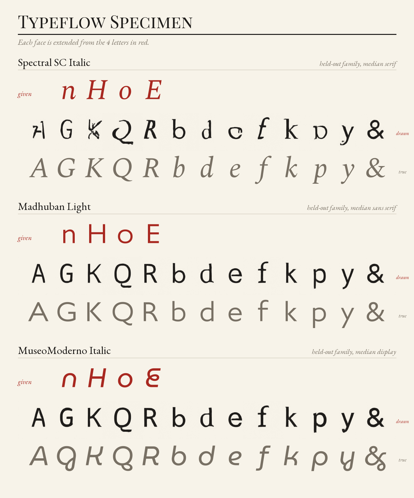
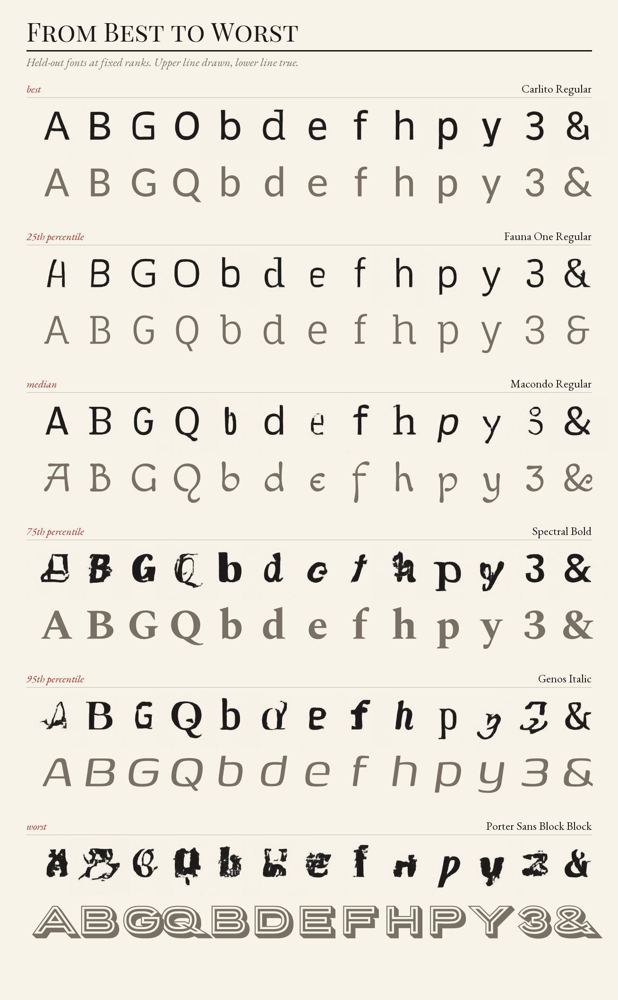
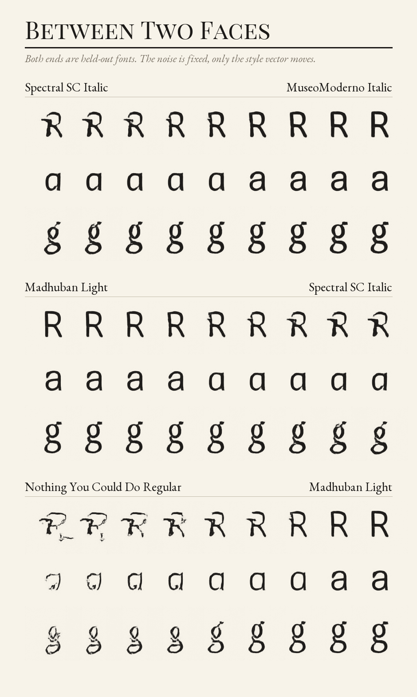
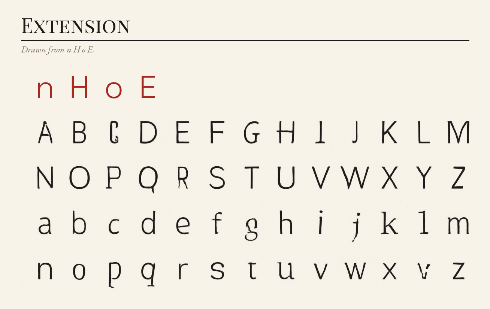
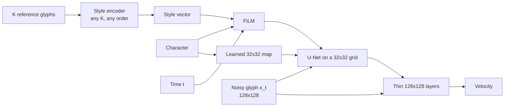
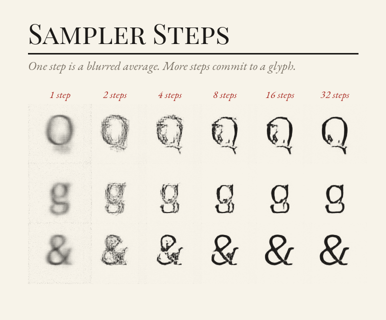

# typeflow

[](https://github.com/matejpopovski/typeflow/actions/workflows/ci.yml)

Show it four letters of a typeface it has never seen and it draws the rest. Give it two typefaces and it moves between them. This is conditional flow matching on rendered glyphs, with the U-Net, FiLM conditioning and ODE samplers written by hand in PyTorch.



Red letters are the only input. Black is what the model drew and grey is what the font really contains. These are not picked for looking good: each is the median font of its category, by rank in the saved scores. They show what the model is like. Weight, proportion and x-height carry over, the italic slant mostly does not, and fine detail comes out rough.

## Read this first: a lookup beats it

The obvious rival to a generative model here is no model at all. Compare the reference letters against every training font, take the closest, and copy its glyphs. On 379 held-out styles, 57 glyphs each, that baseline wins on every metric at every number of references.

| Method | L1 | SSIM | Ink IoU | Perceptual | Legible | Grey share |
|---|---:|---:|---:|---:|---:|---:|
| Mean glyph, no references | 0.0536 | 0.778 | 0.503 | 0.750 | 1.000 | 0.968 |
| Nearest font, 1 letter | 0.0326 | 0.875 | 0.594 | 0.316 | 0.978 | 0.217 |
| typeflow, 1 letter | 0.0429 | 0.812 | 0.479 | 0.453 | 0.850 | 0.371 |
| Nearest font, 4 letters | 0.0291 | 0.883 | 0.618 | 0.286 | 0.975 | 0.227 |
| **typeflow, 4 letters** | **0.0415** | **0.817** | **0.495** | **0.421** | **0.876** | **0.354** |
| Nearest font, 8 letters | 0.0285 | 0.884 | 0.623 | 0.290 | 0.976 | 0.231 |
| typeflow, 8 letters | 0.0417 | 0.817 | 0.492 | 0.424 | 0.873 | 0.357 |
| Oracle font, chosen by seeing the targets | 0.0259 | 0.891 | 0.643 | 0.273 | 0.975 | 0.242 |

Lower is better for L1, perceptual distance and grey share. The gap to the nearest font at 4 letters is +0.135 perceptual (95% interval +0.118 to +0.151, resampled by font cluster), and the model beats the baseline on 9.0% of fonts on that metric. Every row, including 2 letters, is in [`results/tables.md`](results/tables.md).

What explains it:

- **The corpus is dense.** With 3,225 styles to search, four letters almost find the best possible match: 0.286 against 0.273 for an oracle that sees the answer. A copy is also a real font, so its strokes are clean where the model's wobble.
- **The split is not leaking.** A strong baseline is what a leak would look like, so that was measured. Across all characters, no test font is closer than 0.066 to any training font on a scale where 0 is identical ([`results/leak_audit.json`](results/leak_audit.json)). One real relationship does survive: Carlito (test) derives from Lato (train), at 0.072, and Carlito is the model's best-scoring font.
- **Novelty does not rescue the model.** A generator might be expected to overtake a lookup on fonts far from anything in training, so the test set was split by that distance. It does not. The model loses in all four quartiles, even the most novel, at 0.583 against 0.466 perceptual ([`results/novelty.json`](results/novelty.json)). This analysis was designed after seeing the first results, so treat it as exploratory.
- **More references stop helping.** Scores improve from 1 letter to 2 and are flat from 4 to 8. The model averages references into one vector and FiLM can only modulate with it, so extra letters add little that vector can hold.

The worst result is in handwriting, where 61.6% of generated glyphs are legible against 96.3% for sans serifs. Hand-drawn strokes depend on local shape, which a global style vector transfers poorly.



Ranks are fixed in advance and the worst font is shown as readily as the best. Porter Sans Block, an inline shadow face, is outside anything the model can express.

## What a lookup cannot do

A nearest font is always a font that already exists. Interpolation is the one thing here that retrieval cannot attempt, and the style vector makes it a straight line.



Both ends of every row are held-out fonts. Over 40 random pairs, the midpoint glyph has a grey share of 0.324 against 0.714 for a pixel crossfade, so the model draws one glyph while a crossfade shows two ghosts. The crossfade stays more legible to the classifier, 0.969 against 0.906. Motion is even, with the largest frame-to-frame change 1.32 times the mean ([`results/interpolation.json`](results/interpolation.json)). The morph is not continuous in every feature: in the top row the "a" switches from single to double storey within a frame or two, because those are different structures with nothing between them.

Extension also works from any source, including a font's own letters on the command line. This whole alphabet came from `n H o E` of held-out Space Grotesk, using `typeflow extend`. Most of it holds together, but the model adds slab serifs to `I` and `l` that the font does not have, and `C` and `y` are poor.



## The metrics, and why there are six

L1 alone would be misleading in either direction, and no single metric here is safe:

- **L1 and SSIM** are the expected measures, but about 94% of a glyph image is blank paper, and both reward any output that gets the paper right.
- **Perceptual distance** comes from a small classifier trained on training fonts to name the font and the character from one glyph, reaching 38.3% across 3,225 fonts and 96.6% on characters ([`results/perceptual.json`](results/perceptual.json)). It shares no weights with the generator, so the model does not mark its own work. LPIPS was the alternative, but an ImageNet network has no particular reason to care about serifs.
- **Ink IoU** ignores the paper. **Legible** asks whether that classifier reads the intended character. **Grey share** measures blur and nothing else.

The mean glyph row shows why they travel together. The average of every font's "g" has no style at all, yet it is 100% legible and beats the model on ink IoU. Only perceptual distance and grey share expose it.

SSIM is checked against scikit-image in the tests. Scores are averaged per font, and intervals resample whole clusters because styles of one design are not independent.

## The corpus, and the split that makes any of this mean something

Fonts come from the `ofl/` folder of [google/fonts](https://github.com/google/fonts), pinned to one commit, and are not stored here. [`fonts/families.csv`](fonts/families.csv) and [`fonts/styles.csv`](fonts/styles.csv) list every font with its git blob hash. `typeflow fetch` verifies each file against that hash, and reads each family's `OFL.txt` rather than trusting the directory it sits in or its metadata. Fetching and rendering from an empty folder reproduced the training data byte for byte, with SHA-256 `b0a9d78234bf18a028b958840189f4be11c1ccb26b9e7d79a7a7b9d48530d0da` on an M3 Max. The images in this repository are renderings and model outputs, not fonts.

Of 2,017 upstream directories, 1,635 families and 3,794 styles survive. All 449 rejected items are listed with their reasons in [`fonts/rejected.csv`](fonts/rejected.csv): no Latin subset, files over 3 MB, colour fonts, overflow, barcodes, and two directories whose licence text was not OFL 1.1.

**Holding out by family is not enough.** Hind Madurai and Hind Siliguri are separate directories with the same Latin. Many script-specific families reuse an existing Latin outright, including Roboto inside Heebo and Open Sans inside much of Noto Sans. Split by directory, those twins would hand the baseline a perfect copy. So directories are merged into 966 clusters by name stem and by measured similarity, where a pair counts as twins if half their glyphs nearly match. That found 748 pairs of families that share drawings despite having different name stems. Clusters then split 3,225 / 190 / 379 styles into train, validation and test.

The first version of that detector was worse than none. Raw L1 at low resolution called any two thin fonts alike, and similarity chained through the neutral sans faces until most of the corpus formed one cluster, which left a test set dominated by display fonts. Dividing by ink, as a normalised distance, fixed it.

Every style is scaled so that its capital H is the same height on the same baseline, because scaling by em would make size, not design, the largest thing a model has to explain.

## How it works



The network regresses the velocity `x1 - x0` along a straight path from noise to glyph, and sampling integrates that field from t=0 to t=1. The model has 9.7M parameters and draws at 128x128.

Decisions that shaped it, and what was rejected:

- **One global style vector, not cross-attention to the references.** Attention would probably transfer more detail, and may close part of the gap above. A single vector gives interpolation a plain meaning, and that was the point of the project. The table above is partly the cost of that choice.
- **No latent autoencoder.** Glyphs are nearly binary and an autoencoder would have to be trained first from the same time budget.
- **A coarse grid plus thin full-resolution layers.** At the same parameter count and under the same load, a U-Net on a 64x64 grid trained at 58 glyphs per second against 109 on a 32x32 grid ([`results/throughput.json`](results/throughput.json)). Thin layers after the pixel shuffle see the raw input again, so edges are not tied to the patch grid. Capping the deepest level keeps half-precision weights at 19.5 MB, small enough to commit.
- **No data workers.** The corpus is one memory-mapped file and a batch is a few slices of it, so there is nothing to hang between the data and the loop. Rendering does use processes, in a pool that can kill a worker stuck inside FreeType, which the standard pools cannot do.
- **The watchdog is a separate process.** A stuck native call can hold the GIL, in which case a watchdog thread inside the trainer never runs. A parent process watches a heartbeat file and restarts from the last checkpoint, and checkpoints are moved to CPU and written by atomic rename. On a real MPS trainer frozen with SIGSTOP, it detected the stall and resumed from step 114 after 26.2 seconds ([`results/fault_injection.json`](results/fault_injection.json)). The 72 minute run itself had no stalls.

## Three things the unit tests could not find

Everything passed its tests before the first pilot, and the first pilot drew noise. Each fix below was measured on the same 60 validation fonts at about 2,950 steps, which is 8 minutes of training ([`results/pilots.json`](results/pilots.json)).

| Eight minute pilot | Legible | Perceptual | Ink IoU |
|---|---:|---:|---:|
| Global conditioning only, fixed EMA decay | 0.000 | 1.663 | 0.130 |
| Same run, live weights instead of EMA | 0.258 | 0.597 | 0.341 |
| Character maps from random, EMA ramp | 0.414 | 0.567 | 0.388 |
| Character maps seeded from mean glyphs, EMA ramp | 0.807 | 0.496 | 0.460 |

**The EMA was averaging a network that did not exist yet.** With a fixed decay of 0.9995, 23% of the "average" was still the random initial weights after 2,954 steps. The decay now ramps up from zero.

**FiLM cannot say where.** Style transferred from the start, with heavy fonts heavy and thin fonts thin, yet the letters were wrong: a G came out as an 8. FiLM acts on all positions alike and convolution is translation-equivariant, so at t=0, with pure noise as input, a global vector has no way to place the strokes of an A. Each character now owns a learned spatial map, seeded from that character's mean over training fonts. A test asserts the mechanism directly: on a flat input, the output cannot vary with position unless the maps supply it.

**Higher-order solvers were losing to Euler.** Heun at 16 steps had SSIM 0.569 against 0.846 for Euler at 32 steps at the same cost, the wrong way round. The final stage of Heun and RK4 evaluates the network at exactly t=1, where the input contains no noise, so the network cannot know which trajectory it is on. Its velocity's correlation with the true noise falls from 0.998 at t=0.5 to 0.000 at t=1, and the error at t=1 is 1.02, the size of the noise itself. That error stays in the output as grain of amplitude h/2, which is nearly invisible to L1 and very visible to SSIM on blank paper. Sampling now takes a plain Euler step at the end, as the EDM sampler of Karras et al. (2022) also does for its final step. Heun at 16 steps went from 0.569 to 0.842 ([`results/endpoint.json`](results/endpoint.json)).

## Sampler steps

Settings were chosen on validation fonts under a rule fixed beforehand: lowest perceptual distance within 32 velocity calls. The test split was scored afterwards.

| Solver | Calls | L1 | SSIM | Perceptual | Legible | Grey share |
|---|---:|---:|---:|---:|---:|---:|
| Euler, 1 step | 1 | 0.0477 | 0.388 | 0.584 | 0.981 | 0.905 |
| Euler, 4 steps | 4 | 0.0351 | 0.806 | 0.404 | 0.935 | 0.450 |
| Euler, 8 steps | 8 | 0.0357 | 0.834 | 0.390 | 0.897 | 0.348 |
| **Euler, 8 steps, guidance 1.25** | **16** | **0.0353** | **0.835** | **0.390** | **0.892** | **0.354** |
| Euler, 32 steps | 32 | 0.0381 | 0.846 | 0.400 | 0.871 | 0.314 |
| Heun, 16 steps | 31 | 0.0390 | 0.842 | 0.405 | 0.861 | 0.302 |
| RK4, 8 steps | 29 | 0.0399 | 0.832 | 0.409 | 0.851 | 0.295 |

The rule picked the row in bold, though its margin over unguided Euler at half the cost is within noise (0.3896 against 0.3899). Three things stand out:

- **Accuracy stops paying after about 8 steps.** Solving the ODE more precisely, or with a higher-order method, does not make the glyphs better by these measures, because the limit is the learned field.
- **One step is the blurred average of everything plausible.** That is why it scores 98.1% legible and looks like this:



- **The metrics and the eye disagree.** Eight steps leave blotches that 32 steps do not, as the sheet shows, and perceptual distance still prefers 8. Scored on the test split, 32 steps is sharper (grey share 0.305, SSIM 0.829) and worse on L1 and perceptual distance (0.0441 and 0.431).

The headline table therefore stays at the setting the rule chose. All sheets on this page use 32 Euler steps without guidance, picked by eye after scoring, with their ranks taken from that run ([`results/test_euler32.json`](results/test_euler32.json)). Interpolation numbers use the headline setting.

## Running it

Setup and tests need no downloads beyond dependencies. Weights are in the repository, and CI runs on Linux x86-64 on CPU with a tiny model and synthetic fonts built by fontTools.

```sh
uv sync --frozen
uv run --frozen pytest
```

Extending a font and interpolating between two need only font files:

```sh
uv run --frozen python -m typeflow extend --font YourFont.ttf --letters nHoE \
    --steps 32 --guidance 1.0 --out extension.png
uv run --frozen python -m typeflow morph FontA.ttf FontB.ttf --steps 32 --guidance 1.0 --out morph.png
```

`extend` also takes `--glyphs folder/` with `n.png`, `H.png` and so on, as 128x128 dark-on-light images placed on the baseline of the training frame. Sampling needs Apple silicon or a GPU to be pleasant: on an M3 Max shared with other jobs, MPS drew 54.7 glyphs per second at 16 velocity calls against 3.5 on the CPU ([`results/decode_speed.json`](results/decode_speed.json)), so evaluation ran on MPS.

To reproduce the results, in order:

```sh
uv run --frozen python -m typeflow fetch                 # 680 MB, about 2 minutes
uv run --frozen python -m typeflow render --size 128     # 4 GB, under a minute
uv run --frozen python -m typeflow supervise --run runs/main --minutes 72
uv run --frozen python -m typeflow perceptual
uv run --frozen python -m typeflow export --run runs/main
uv run --frozen python -m typeflow sweep
uv run --frozen python -m typeflow evaluate
uv run --frozen python -m typeflow evaluate --steps 32 --method euler --guidance 1.0 \
    --reference-counts 4 --results results/test_euler32.json --outputs data/outputs-euler32
uv run --frozen python -m typeflow interpolate
uv run --frozen python -m typeflow figures --steps 32 --method euler --guidance 1.0 \
    --results results/test_euler32.json --outputs data/outputs-euler32
uv run --frozen python scripts/tables.py
uv run --frozen python scripts/novelty.py
uv run --frozen python scripts/leak_audit.py
uv run --frozen python scripts/endpoint_study.py
uv run --frozen python scripts/fault_injection.py
uv run --frozen python scripts/decode_speed.py
uv run --frozen python scripts/throughput.py
```

`typeflow survey` rebuilds the manifest in `fonts/` from upstream, which only matters when changing the pinned commit. `scripts/pilots.py` needs the local pilot checkpoints, which came from code before the fixes and are not in the repository.

The training run took 24,438 steps in 72 minutes on an Apple M3 Max with 36 GB of RAM, at a median of 6.5 steps per second, sharing the GPU with other jobs ([`results/training_log.jsonl`](results/training_log.jsonl)). It stayed under 10 GB of memory. One run, one seed, so the numbers carry no estimate of variation between training runs.

## Limitations

- **It does not beat copying the nearest font**, on any metric here, on a corpus this dense. If a similar font exists, use that font.
- **Output is 128 pixel greyscale, not a font.** There are no outlines, no spacing or kerning, and no hinting. Nothing here produces a usable `.ttf`.
- **Italics are mostly lost.** On the sheets the slant rarely survives into generated glyphs, and neither do ornament, inline detail or blackletter structure. This is an observation, not a measurement. Handwriting is the weakest category.
- **The character set is 65 glyphs**: A to Z, a to z, digits and `& ? !`. There is no accented Latin and no other script.
- **Fonts had to fit the frame.** Styles with very wide or tall glyphs were rejected, so the most extreme display and script faces were never seen or tested.
- **Training stopped at the time budget, not at convergence.** Loss was still falling slowly at the end of the schedule, and a longer run or a heavier model might narrow the gap.
- **Generated paper is not perfectly blank.** Faint residual noise is visible on the sheets, which place glyphs without scaling or clean-up.
- **The perceptual metric has blind spots**, as the step-count result shows. It was fixed before the test split was scored, and its features are specific to this project, so its values do not compare with any published LPIPS figure.
- **The split merges on shared drawings, not shared designers or close influence.** Fonts by one designer can land on both sides, and the Carlito and Lato pair shows the detector can miss a true derivative.
- **Very large clusters stay in training** so that one design cannot dominate the test score, so the Noto and Open Sans group is never tested.

## Licence

Code and weights are MIT. Fonts are not included. They remain under the SIL Open Font License 1.1 with their authors, as recorded per family in `fonts/families.csv`.
